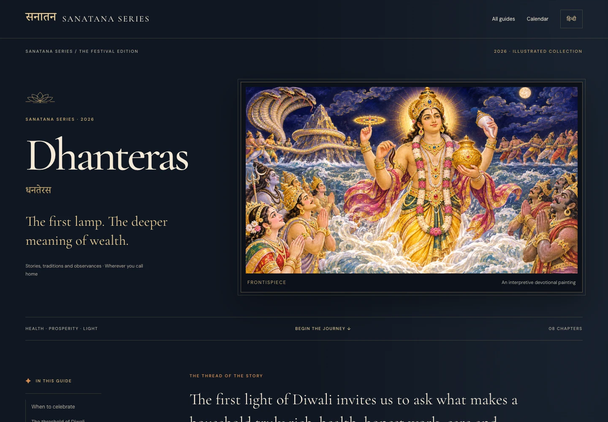
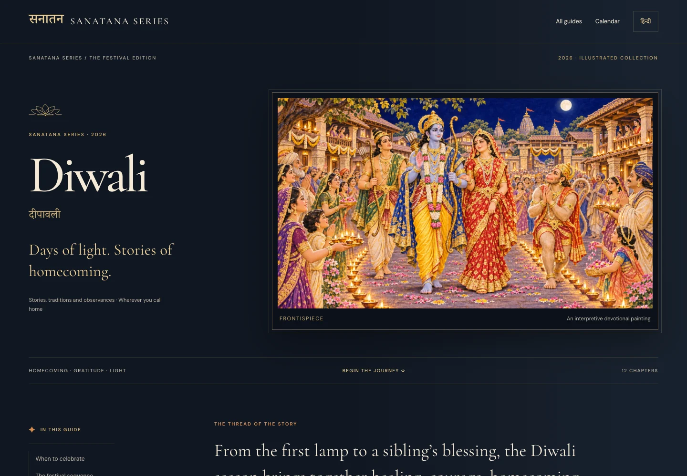
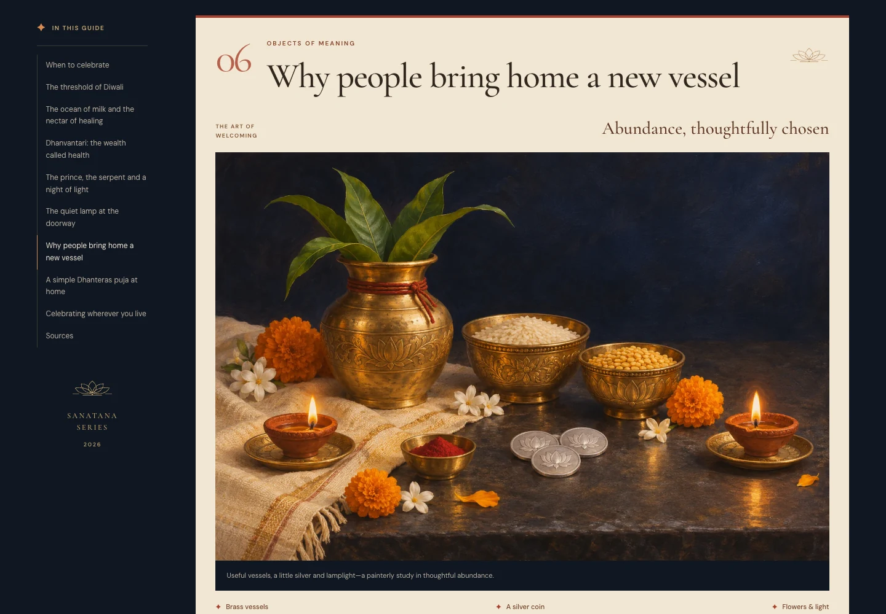
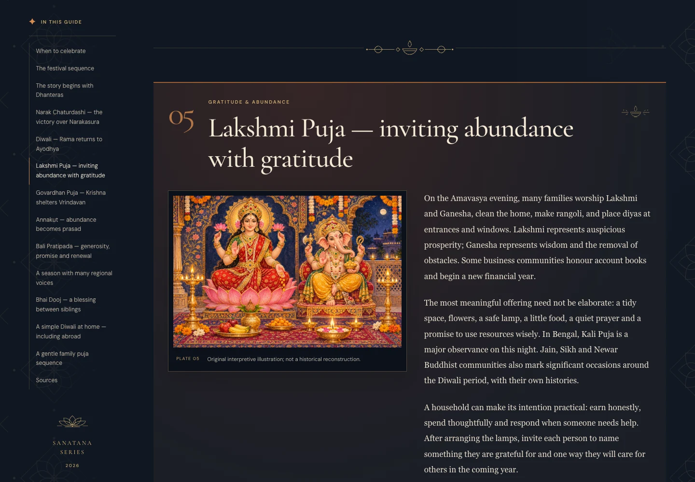
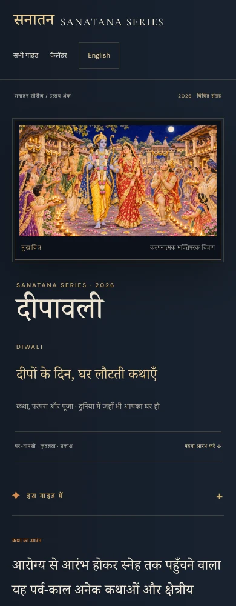

# Heritage editorial redesign · 7 November 2026

The four Dhanteras and extended Diwali guides now present their existing stories as an illustrated cultural publication: visible, uncropped frontispieces; generous reading columns; numbered chapters; restrained lotus ornament; alternating panoramic and paired image/text compositions; and warm ivory and vermilion passages within the midnight palette. Mobile artwork leads the introduction, and a native disclosure keeps the contents compact. Hindi uses Noto Serif Devanagari with its own spacing and line-height metrics.

## Content preservation

Baseline: `a91b268abd19a61269c38d8d12f93c2ff8f447bb` (the published guides). The preservation check confirms that 274 original text blocks, 140 original links, all 48 image occurrences with their alt text, existing IDs and all metadata are retained across the four pages. The entire date/local-panchang section is unchanged, including its global-diaspora guidance. No calendar data, homepage, other guide or previous illustration was replaced. See [content-preservation.json](content-preservation.json).

The only new editorial text is concise navigational framing, artwork captions and two explicitly contextualized scriptural reflections. These do not replace any story or prescribe an additional festival ritual.

## Artwork assessment

Keep all existing story paintings, including the six architecture-reviewed versions documented in [the architecture review](../illustration-architecture-review.md). They fit their narratives and show more clearly without the previous dark hero overlay. No painting needs regeneration for this design change. All principal story images retain natural proportions; decorative framing does not crop the paintings.

The existing Dhanteras craft-shop scene is retained. A new original still life supplements it: brass vessels, lotus-embossed silver coins, marigold/jasmine and earthen lamps on metal saucers. It contains no architecture or deity iconography. It illustrates modest, useful household purchases rather than implying that costly shopping is mandatory. WebP: 276,406 bytes, 1536 × 1024. The exact generation prompt and checksum are in [the provenance record](../festival-artwork-2026.json).

## Verified Sanskrit additions

- Dhanteras: Bhagavad Gītā 17.20, generosity without expectation of return. Sanskrit verified against [the published text](https://vedabase.io/en/library/bg/17/20/); English/Hindi meanings are our paraphrases. Explicitly labeled as a reflection on giving, not a prescribed Dhanteras mantra.
- Diwali: `तमसो मा ज्योतिर्गमय ।`, an excerpt from Bṛhadāraṇyaka Upaniṣad 1.3.28, verified against [the source text](https://upanishads.org.in/u/brihadaranyaka/p/1.3.28). The normalized sandhi joins `ज्योतिर् गमय` as `ज्योतिर्गमय`. Explicitly labeled a reflection on light, not a prescribed Diwali mantra.

Both sources are linked in both language versions and their bibliographies.

## Performance and accessibility

Cormorant Garamond, DM Sans and Noto Serif Devanagari are self-hosted WOFF2 subsets with `font-display: swap`, system/serif fallbacks and accompanying SIL Open Font Licenses in `fonts/festival/`. All seven subsets total 299,036 bytes; Unicode ranges let browsers request only those needed. There are no external font requests. Existing art remains lazy-loaded with dimensions; only the frontispiece is prioritized. The new JavaScript is a small optional enhancement for contents disclosure and chapter highlighting. Reading, anchors and contents work without JavaScript.

Keyboard focus is visible, the skip link and bilingual switch remain functional, motion preferences are respected, and reflow was checked down to 320px. Paintings retain their existing descriptive alt text; ornamental lotuses are hidden from assistive technology.

## Validation and visual review

- Existing festival validator: passed.
- Existing changed-page link/image check from `.github/workflows/validate.yml`: passed for all four changed HTML pages.
- Content/metadata/date preservation: passed.
- Browser QA: 24 combinations, including homepage and calendar regression checks at 360, 390, 768 and 1440px; no horizontal overflow, broken images or JavaScript errors. [Report](browser-check-2026.json).
- Additional 320px reflow, reduced-motion, local-only assets and no-JavaScript checks: passed. [Report](progressive-enhancement-check.json).
- Desktop/mobile screenshots were visually reviewed for all four heroes plus representative chapters and the purchase section. Iteration increased small caption sizes, enlarged navigation targets moved fonts to local hosting, and corrected Devanagari chapter-number wrapping.
- `git diff --check`: passed.

No known automated failures remain. Browser review used installed Chrome; Safari/Firefox and screen-reader testing were not performed. The owner approved publication on 7 November 2026 after requesting a distinct Deepavali pattern treatment and asking that Dhanteras stay unchanged. Publication follows the existing GitHub Pages setup through PR #3.

Reproduce from a local HTTP preview on port 8765 (install Playwright in your Python environment; pass `--chrome` for an installed browser if necessary):

```sh
python3 scripts/validate_festival_guides.py
python3 scripts/check_festival_preservation.py --base-ref a91b268abd19a61269c38d8d12f93c2ff8f447bb
python3 scripts/check_festival_layouts.py --output-dir docs/redesign
python3 scripts/check_festival_design.py
```

## Screenshots

| Guide | Desktop | Mobile |
| --- | --- | --- |
| Dhanteras | [English](screenshots/dhanteras-1440.webp) · [Hindi](screenshots/dhanteras-hi-1440.webp) | [English](screenshots/dhanteras-390.webp) · [Hindi](screenshots/dhanteras-hi-390.webp) |
| Diwali | [English](screenshots/diwali-1440.webp) · [Hindi](screenshots/diwali-hi-1440.webp) | [English](screenshots/diwali-390.webp) · [Hindi](screenshots/diwali-hi-390.webp) |





Additional Hindi close-ups: [Sanskrit reflection and chapter typography](screenshots/dhanteras-hi-details.webp) · [date panel and sequence](screenshots/diwali-hi-details.webp).

## Deepavali-specific ornament · approved publication refinement

Both Deepavali language versions now have original, lightweight SVG rangoli-inspired floral geometry in the outer margins, a diya motif in chapter headings and the hero, fine corner details around the frontispiece, and lamp-and-flower chapter separators. These are decorative designs, not sacred diagrams or claims to reproduce a particular regional tradition. The motifs reflect welcoming thresholds and lamplight; no deity or sacred syllable is used as wallpaper. The pattern was reduced in contrast and spaced more generously after desktop review. Mobile keeps it at the extreme edges.

All new CSS selectors are scoped to `guide-diwali`. Neither Dhanteras HTML file nor its artwork was changed. Full-page screenshot comparisons of English and Hindi Dhanteras at 1440px and 390px are pixel-identical to the approved design: [comparison results](dhanteras-unchanged-check.json). All original prose, links, dates and SEO metadata remain unchanged in all four guides.



